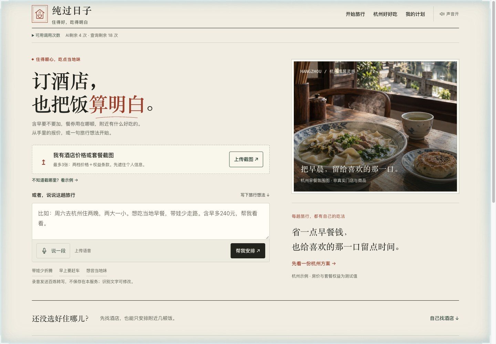
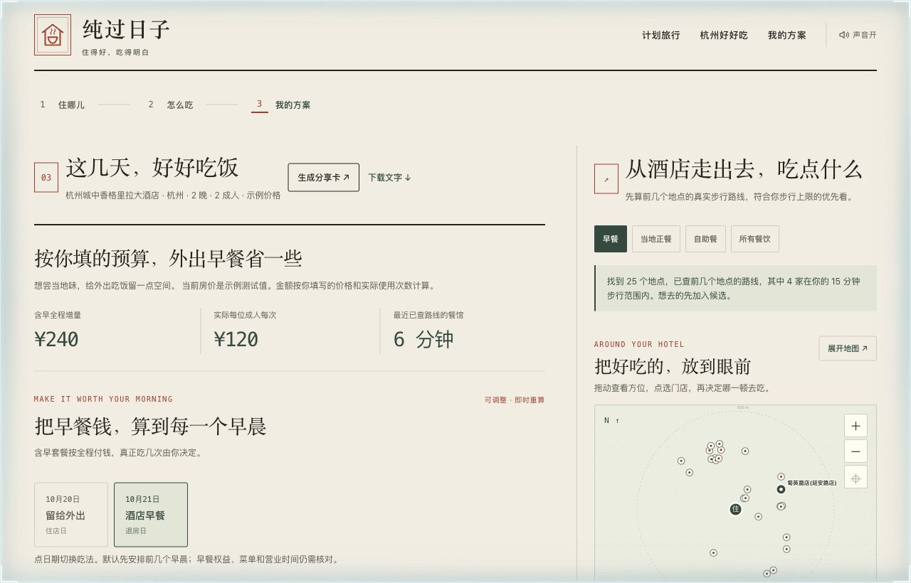

# 纯过日子｜订酒店，也把饭算明白

2026 飞猪 AI 旅行创新大赛作品。用 **飞猪 FlyAI + 阿里云百炼**，把酒店含早差价、酒店餐券和周边三餐放进同一份可以修改的计划。

> 多买的早餐用得上吗？孩子那份怎么算？走出去吃会不会太折腾？套餐晚餐能安排在哪一天？

[观看演示视频（投稿页内播放）](https://github.com/modelstudioai/modelstudioai.github.io/issues/177) · [下载视频](docs/demo/纯过日子-参赛演示.mp4) · [演示脚本](docs/demo/script.md) · [数据说明](docs/data-scope.md) · [公开文件检查](docs/privacy-check.md)



## 怎么用

1. 口述或输入旅行需求。百炼转写并提取城市、酒店、日期、同行人、忌口、预算和步行上限；识别结果可以修改。
2. 通过飞猪候选选择酒店，或上传订房截图。仅提取可见的价格与权益，再由用户核对。
3. 确认两档房价条件一致，按实际会吃到的早餐次数比较差价；儿童补买与餐券条款不清楚时显示待确认。
4. 查附近餐馆与真实步行路线，在可拖动的坐标方位图中选店、加入三餐候选，保存方案和个人用餐笔记。



## 百炼运行时链路

| 环节 | 模型与接口 | 输入 → 输出 |
| --- | --- | --- |
| 语音转写 | `qwen-audio-3.1-asr-flash`，DashScope 原生接口 | 16 kHz WAV → 可修改文字 |
| 旅行需求提取 | `qwen3.8-flash`，OpenAI 兼容接口 | 文字 → 含原句证据的旅行条件 JSON |
| 订房截图识别 | `qwen3.8-flash`，OpenAI 兼容接口 | 图片 → 可见日期、房型、房费、早餐份数与餐券次数 |
| 优先问店清单 | `qwen3.8-flash`，OpenAI 兼容接口 | 结构化条件 → 最多三项待核事项 ID |

核心价格运算由代码完成，模型不能修改算式。固定示例的讲解使用预设内容，并明确标注“不调用百炼”。

2026-10-12 已通过实际服务接口验证：合成测试语音“周六去杭州住两晚，两大一小，想吃当地早餐，不吃海鲜，最多走十分钟”被正确转写，并提取杭州、两晚、2 成人 1 儿童、不吃海鲜、步行 10 分钟等条件。该测试不含真实用户录音。

## 本地复现

需要 Node.js 20+；项目没有 npm 运行时依赖。实时酒店查询另需 FlyAI CLI，示例页面与资料库可以直接运行。

```bash
npm install -g @fly-ai/flyai-cli@1.0.16
cp .env.example .env
# 在本机 .env 中填自己的服务端密钥；不要上传该文件。
node --env-file=.env server.mjs
```

打开 `http://127.0.0.1:4173/`，先点“看一份杭州方案”。密钥字段都是空值；没有密钥时，实时语音、截图和地图接口不能使用，固定示例价格计算与本地资料仍可查看。

FlyAI CLI 需要自己的有效认证；通过其官方配置流程登录，或设置服务端 `FLYAI_API_KEY`。普通本地启动沿用 FlyAI CLI 已有配置；容器入口会使用环境变量配置该 CLI。项目只在本地显式设置 `ALLOW_LOCAL_BAILIAN_CONFIG=1` 时才会读取本机百炼 CLI 配置，公开部署应使用服务端环境变量。

也可用附带 Dockerfile 打包单实例服务。2026-10-13 已在本机构建并验证容器的固定示例、资料接口和重启后的持久限额；公网 HTTPS 与云端实时接口仍待部署验收。

## 当前交付范围

- 响应式网页，包含全国城市选择；杭州是深度餐饮示范城市。
- 提供运行视频、实际截图和源码复现；实时服务尚未公开部署，视频中的本地地址不是公网试用地址。
- 飞猪候选查询目前使用体验模式，列表价格档位不能当作同房型含早与不含早的成交价。
- 真实飞猪公开截图：2026-10-12 查看、2026-11-01 至 11-02 入住、同卖家的特价大床房，无早 ¥303、单早 ¥362。它是历史页面快照，其他权益和最终价格仍需进入预订页核对。
- 视频中的 ¥1200 / ¥1440 是测试输入；只吃一天酒店早餐时，¥240 ÷ 2 成人 ÷ 1 次 = ¥120/人/次。
- 坐标图是门店方位示意，不显示街道；步行时间由地图路径服务查询。地点、参考评分和价格不等于当天菜单或过敏安全承诺。
- 酒店官网与网络公开政策快照分别标注采集时间，并保留真实来源链接。

模型调用默认每 IP 每小时及每天各 5 次、全站每天 30 次。本地默认在内存计数；生产模式必须设置 `MODEL_QUOTA_FILE` 指向持久卷，计数写入失败会关闭实时调用，重启不会清零。当前持久账本适用于单实例演示，日界线为北京时间零点。无自备域名的免费方案使用 Supabase 原子预留次数，避免容器休眠清零；配置与限制见 [公网部署准备](docs/deployment.md)，仍需 HTTPS 和模型账户预算保护。

## 数据与隐私

交付 JSON 含 20 家酒店深度资料、25 家酒店早餐政策、6 家酒店官网早餐补充、3 家可核到具体分店的早餐店、59 家外部专题门店，以及 216 家去重餐馆资料。不同集合可能重叠，不能相加称为全市覆盖；当天营业、菜单、现价、儿童规则及忌口需再确认。

不发布真实个人订单、用户录音、密钥、账号额度页或本机登录配置。截图为公开商品页或合成测试案例。录音和原图不在服务端持久保存；个人餐馆笔记只留在当前浏览器，导出的方案由用户自己保管。
