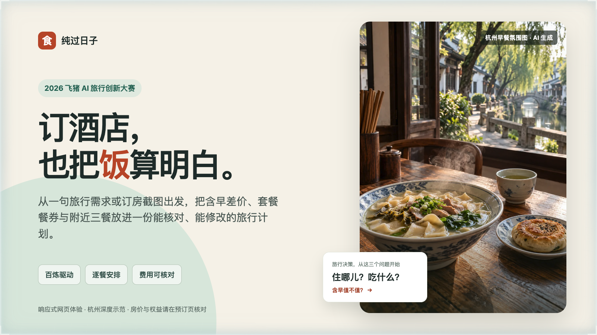
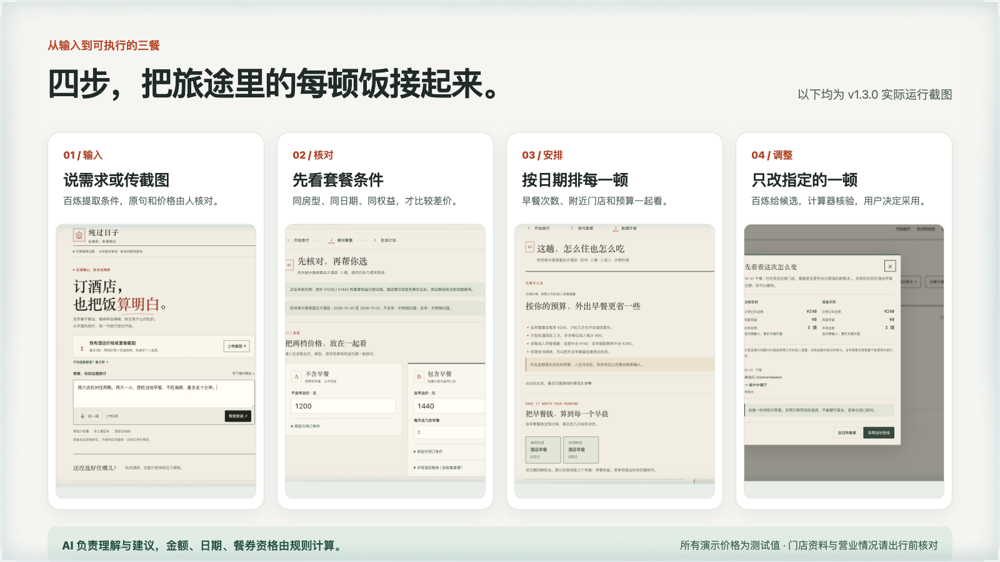
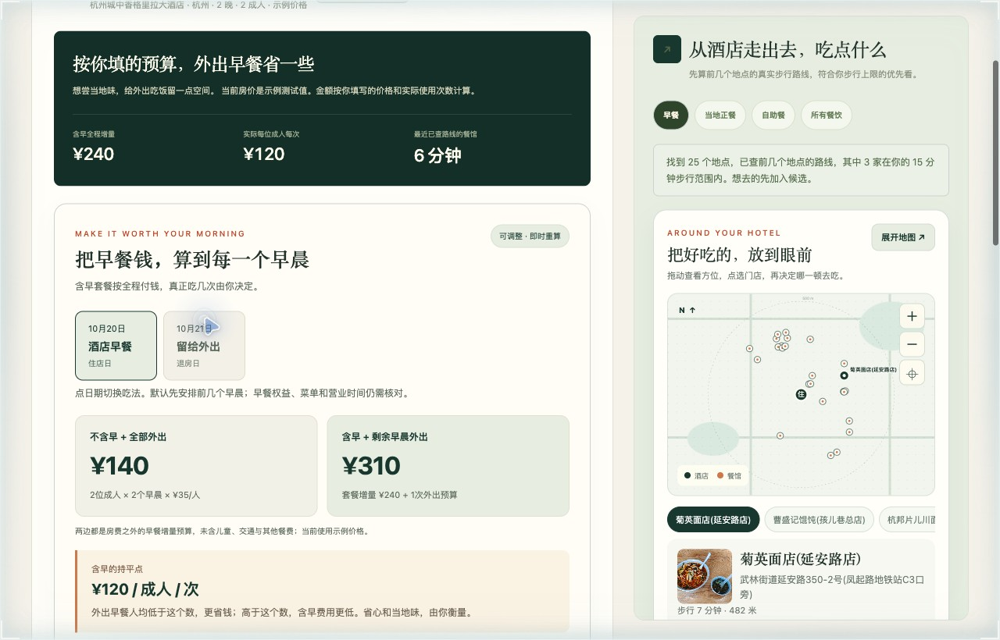

# 纯过日子｜订酒店，也把饭算明白



2026 飞猪 AI 旅行创新大赛作品。从一句旅行需求或订房截图开始，把酒店含早差价、套餐餐券和周边三餐放进同一份可以核对、修改和分享的计划。

> 多买的早餐用得上吗？孩子那份怎么算？走出去吃会不会太折腾？套餐晚餐能安排在哪一天？

[公网体验](https://47.238.228.164/) · [观看演示视频（投稿页内播放）](https://github.com/modelstudioai/modelstudioai.github.io/issues/179) · [下载视频](docs/demo/纯过日子-参赛演示.mp4) · [演示脚本](docs/demo/script.md) · [数据说明](docs/data-scope.md) · [公开文件检查](docs/privacy-check.md)

演示视频长约 2 分 10 秒，采用实际运行画面剪辑、中文讲解和字幕。房价、餐券与反馈为明确标注的示例输入；地图地点和步行路线来自实际查询。



> 流程图中的画面为 v1.3.0 实际运行截图；封面使用本项目 AI 生成的杭州早餐氛围图。当前公网体验仍为 v1.3.0，界面优化版本待完成后发布。


## 怎么用

1. 口述或输入旅行需求。百炼转写并提取城市、酒店、日期、同行人、忌口、预算和步行上限；识别结果可以修改。
2. 通过飞猪候选选择酒店，或上传订房截图。仅提取可见的价格与权益，再由用户核对。
3. 核对 A/B 两档全程房价与权益，按真正会用到的早餐日期比较；查看房费加所列成人餐费，已核金额、预算与未知项分别列出。
4. 查附近餐馆与真实步行路线，为具体餐次选店、锁定、核对供餐和菜单；先看安排差异再采用，也可以撤回。

## 把早餐钱算到每一个早晨

点选具体日期，比较“不含早全部外出”和“含早后剩余早晨外出”的成人早餐增量预算；查看持平的人均价和不同使用次数的单次成本。逐餐安排同步更新，也可以生成同行分享卡。儿童收费未知、套餐份数不足和房型不可比时保留待核边界。

[决策设计与验证](docs/decision-design.md)。完整验证使用 Node.js 20+ 与 Python 3，运行 `npm test`。全国城市列表使用公开行政区快照，即使实时查询超限仍可选择城市。



## 把酒店与附近三餐接起来

早餐选择可以接上午晚餐、到离店时刻和实际步行时间。供餐、完整起止时段、成人菜单价、税费与忌口分别核对，并绑定具体门店、日期与餐次；只核一项或一天不会替其它项目确认。公开营业时间与历史价格保留为参考。

整体套餐比较将每档全程房费计算一次，再加同一范围内列出的成人餐费。不同餐次覆盖、仍有待核成人金额或儿童金额未知时，页面保留明确的费用范围。房型、退改或其它权益不同，仍不能把全部房价差额归为早餐费。

[查看整体套餐比较画面](docs/screenshots/14-package-comparison.jpg) · [查看单餐修改预览](docs/screenshots/15-ai-meal-preview.jpg)

餐券按分店、所选菜单、餐次、日期、人数、次数、最低消费、预约、叠加及额外费用核对。条件不完整或不匹配时不抵扣，券面值不会自动变成节省金额。

[查看示例餐券核对画面](docs/screenshots/16-voucher.jpg)

## 一起看，也能继续调整

分享前可查看会包含的酒店、日期、同行人数、餐次与费用范围。只读链接在浏览器生成，不上传保存分享内容；持有链接的人可查看和转发，原始截图、录音与私人笔记不进入快照。也可保存原有图片分享卡或下载文字方案。

吃过之后，可选填本次实付、等位、口味和同行接受度。后续午晚餐在供餐、时间、路线和忌口等条件判断后参考同一具体门店的本次反馈，并说明原因；锁定选择保留，实付只作回顾，不改菜单价、预算或券抵扣。反馈仅留在本次浏览器会话。

[查看示例反馈输入](docs/screenshots/17-feedback.jpg) · [查看同行只读快照](docs/screenshots/18-readonly-share.jpg)

## 报价与截图核对

每档报价分别绑定酒店与入住日期。换住处、改日期或退出示例后，旧报价与同条件确认失效。最多3张截图逐张保留，由用户核对后选择不含早A或含早B；识别冲突不会以后图覆盖前图。两档房型、退改或额外餐券权益不同时，不能把全部差额归为早餐费用。

首页可直接从截图、语音或文字开始。结果先给出成人早餐预算差额、计算原因和影响本次选择的待确认项；逐餐安排、附近选店与可展开的费用依据接在同一页。外出金额按用户填写的预算计算，不能当成门店菜单报价。

## 百炼运行时链路

| 环节 | 模型与接口 | 输入 → 输出 |
| --- | --- | --- |
| 语音转写 | `qwen-audio-3.1-asr-flash`，DashScope 原生接口 | 16 kHz WAV → 可修改文字 |
| 旅行需求提取 | `qwen3.8-flash`，OpenAI 兼容接口 | 文字 → 含原句证据的旅行条件 JSON |
| 订房截图识别 | `qwen3.8-flash`，OpenAI 兼容接口 | 图片 → 可见日期、房型、房费、早餐份数与餐券次数 |
| 优先问店清单 | `qwen3.8-flash`，OpenAI 兼容接口 | 结构化条件 → 最多三项待核事项 ID |
| 单餐修改 | `qwen3.8-flash`，OpenAI 兼容接口 | 指定餐次与候选摘要 → 一家候选或澄清请求；重算后预览，由用户采用 |

核心价格运算由代码完成，模型不能修改算式。固定示例的讲解使用预设内容，并明确标注“不调用百炼”。

单餐修改先由用户选定日期和餐次。AI 只能在提供的具体门店中提出候选；现有计算器重新核对条件后展示差异，采用前保留原安排，其它餐次和锁定选择不随建议更换。

## 本地复现

需要 Node.js 20+；项目没有 npm 运行时依赖。实时酒店查询另需 FlyAI CLI，示例页面与资料库可以直接运行。

```bash
npm install -g @fly-ai/flyai-cli@1.0.16
cp .env.example .env
# 在本机 .env 中填自己的服务端密钥；不要上传该文件。
node --env-file=.env server.mjs
```

打开 `http://127.0.0.1:4173/`，先点“看一份杭州方案”。密钥字段都是空值；没有密钥时，实时语音、截图和地图接口不能使用，固定示例价格计算与本地资料仍可查看。

FlyAI CLI 支持默认体验模式（酒店候选可能受限）；增强查询使用自己的有效认证，通过官方配置流程配置，或设置服务端 `FLYAI_API_KEY`。普通本地启动沿用 FlyAI CLI 已有配置；容器入口会使用环境变量配置该 CLI。项目只在本地显式设置 `ALLOW_LOCAL_BAILIAN_CONFIG=1` 时才会读取本机百炼 CLI 配置，公开部署应使用服务端环境变量。

也可用附带 Dockerfile 打包单实例服务。公网体验使用香港云服务器与 IP HTTPS，支持证书自动续期和持久限额；比赛演示服务保留至2026年12月25日，12月26日00:00（北京时间）自动释放。无域名部署步骤见 [IP HTTPS 部署](deploy/ip-https.md)。

## 当前交付范围

- 响应式网页，包含全国城市选择；杭州是深度餐饮示范城市。
- 提供运行视频、实际截图和源码复现；完整云端服务已公开，可通过体验链接使用；视频中的本地地址不是公网试用地址。
- 飞猪候选查询目前使用体验模式，列表价格档位不能当作同房型含早与不含早的成交价。
- 真实飞猪公开截图：2026-10-12 查看、2026-11-01 至 11-02 入住、同卖家的特价大床房，无早 ¥303、单早 ¥362。它是历史页面快照，其他权益和最终价格仍需进入预订页核对。
- 视频中的 ¥1200 / ¥1440 是测试输入；只吃一天酒店早餐时，¥240 ÷ 2 成人 ÷ 1 次 = ¥120/人/次。
- 坐标图是门店方位示意，不显示街道；步行时间由地图路径服务查询。地点、参考评分和价格不等于当天菜单或过敏安全承诺。
- 酒店官网与网络公开政策快照分别标注采集时间，并保留真实来源链接。

模型调用默认每 IP 每小时及每天各 5 次、全站每天 30 次。次数按预留的请求计算，语音转写和需求提取各占一次，预留后失败也计次；生成一份方案可能包含多次调用。实时酒店和地图查询另限全站100次/日、每IP每小时及每天各20次，公共查询命中缓存不扣次数。页面可只读查询剩余次数与北京时间重置时刻，读取余额不耗额度。

生产模式使用持久账本，计数写入失败会关闭实时调用，重启不清零；日界线为北京时间零点。当前账本适用于单实例演示，备用 Supabase 计次后端未提供只读余额时会显示不可用。配置与限制见 [部署说明](docs/deployment.md)。

## 数据与隐私

交付 JSON 含 20 家酒店深度资料、25 家酒店早餐政策、6 家酒店官网早餐补充、15 家逐餐政策资料、3 家可核到具体分店的早餐店、59 家外部专题门店，以及 216 家去重餐馆资料。不同集合可能重叠，不能相加称为全市覆盖；当天营业、菜单、现价、儿童规则及忌口需再确认。

不发布真实个人订单、用户录音、密钥、账号额度页或本机登录配置。截图为公开商品页或合成测试案例。录音和原图不在服务端持久保存；个人餐馆笔记只留在当前浏览器，导出的方案由用户自己保管。
