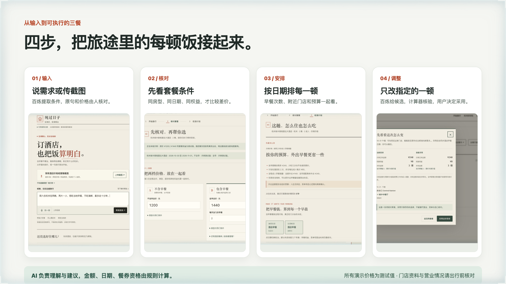
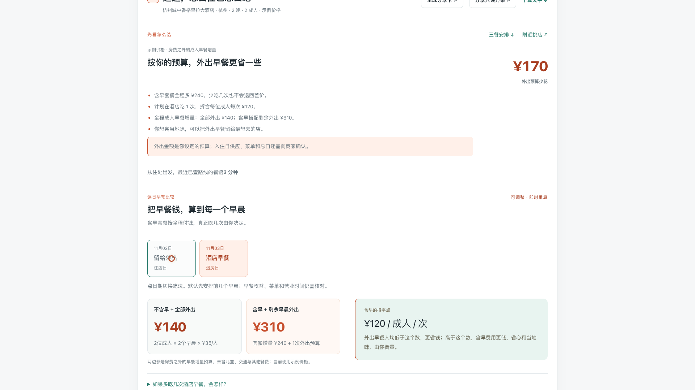
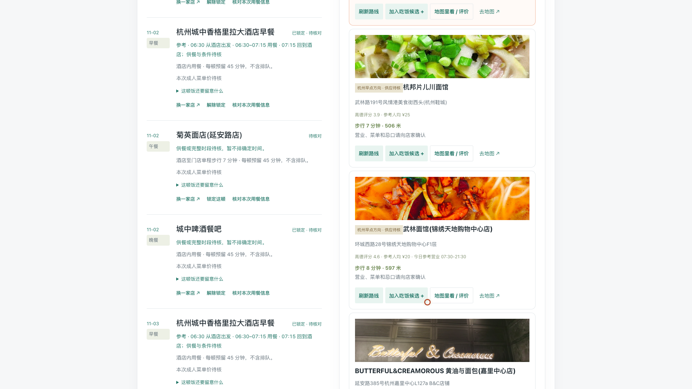

**最终参赛版本：v1.3.4。** 纯过日子是百炼驱动的响应式网页。从一句话或订房截图出发，核对酒店与套餐，再按日期安排三餐。AI 用于理解条件和提出单餐候选；金额、日期、餐券资格由规则计算，重要选择由用户确认。

[观看 3D 宣传片（72 秒）](https://github.com/Bowen-Tian-0305/chunguorizi-feizhu-2026/releases/download/v1.3.3/promo-v1.3.3.mp4) · [体验网页（11 月 28 日 00:00 北京时间开放）](https://47.238.228.164/) · [查看源码](https://github.com/Bowen-Tian-0305/chunguorizi-feizhu-2026/tree/v1.3.4)

## 评委快速体验 · 约 30 秒

**含早贵 ¥240，少吃一次还值吗？** 打开网页，点「先看杭州示例」（桌面端点「查看示例方案」）。在「逐日早餐比较」里，把一个早晨从「酒店早餐」切成「留给外出」。

- **切换前**：2 位成人吃 2 次，含早差价摊到每人每次是 **¥60**。
- **切换后**：仍多付 ¥240，但只吃 1 次，持平点变为 **¥120／成人／次**。按示例里的外出预算 ¥35／成人，两天都外出预计花 ¥140，含早加一次外出预计花 ¥310。两个数字都只算早餐增量预算。

这条路径使用固定测试价，无需登录，也无需使用百炼。11 月 28 日开放前，可先看 [手机实拍结果](https://raw.githubusercontent.com/Bowen-Tian-0305/chunguorizi-feizhu-2026/main/docs/showcase/judge-breakfast-v1.3.4.jpg)。

## 参赛项目名称

**纯过日子｜订酒店，也把饭算明白**

从一句旅行需求或订房截图开始，把酒店含早、套餐餐券与附近三餐放进一份可以核对、修改和分享的安排。

## 团队 / 作者与奖品领取人

- 团队名称：纯过日子
- 唯一主要提交人及赛事对接人 GitHub ID：@Bowen-Tian-0305
- 其他成员：无
- [最终参赛主帖 #179](https://github.com/modelstudioai/modelstudioai.github.io/issues/179)。[旧帖 #177](https://github.com/modelstudioai/modelstudioai.github.io/issues/177) 已关闭并标记作废。

## 旅行场景与目标用户

情侣、亲子和独自旅行的人订酒店时，需要一起决定住哪里、早餐怎么吃、什么时候出门，以及套餐里的晚餐用不用得上。含早多花的钱、儿童补买、步行和等位时间，常常分散在不同页面里。

纯过日子把这些决定落到具体日期和餐次。先核对房价条件，再按真正会吃到的次数计算；把已核菜单金额、用户预算和未知费用分别列出，让同行人看懂同一份安排。

## 我做了什么

1. **从语音、文字或截图开始。** 百炼转写并提取有原句证据的旅行条件；订房截图逐张保留、独立绑定酒店和日期，用户核对后再采用价格。飞猪候选用于选酒店和预订跳转，体验模式列表价格不当作成交价。
2. **把含早算到每一个早晨。** 根据成人数量、早餐份数、实际使用日期和出门时间比较含早增量。房型、退改、支付或其它权益不同，不能把全部房价差额解释为早餐费；儿童收费未知时保留待核。
3. **比较整档套餐现金支出。** 每档全程房费只计算一次，再叠加同一范围内列出的成人餐费；确认价、预算与未知项分别显示。不同餐次覆盖、有待核成人金额或示例与真实输入混用时不排名。
4. **安排酒店与附近三餐。** 按具体日期选店、锁定一顿、预览差异、采用或撤回。酒店与餐馆供餐、完整时段、路线、菜单价和忌口逐项核对；只确认一天不会外溢到其它日期。方位图帮助选具体门店，步行时间来自路径服务。
5. **把餐券落实到所选菜单。** 核对分店、菜单、餐次、日期、人数、次数、最低消费、预约、叠加和额外费用，条件完整且匹配才计入抵扣。券面值和未确认权益不会直接当作现金优惠。
6. **只改想改的那一顿。** 先选日期和餐次，百炼只从当前具体门店候选中提出单餐建议；现有计算器重新核对条件，展示前后差异，由用户决定是否采用。其它餐次和锁定安排保留，可撤回。
7. **一起看，也可按用餐感受调整。** 用户主动生成同行只读快照，分享前可核对内容；原始订单截图、录音和私人笔记不进入链接。吃过后的实付、等位与口味可在当前页面会话记录并影响后续同档候选，实付不改菜单价或预算。
8. **随时查看调用余额。** 显示 AI 与实时查询的剩余调用次数及重置时间；按请求次数计，不把一次请求说成多份方案额度。

## 百炼使用说明

- 模型：`qwen-audio-3.1-asr-flash` 用于语音转写；`qwen3.8-flash` 用于旅行条件提取、订房截图理解、待核事项筛选和单餐候选建议。
- 使用环节：**应用运行时**。用户使用语音、提交旅行需求或截图，或发起待核事项、单餐建议等操作时，Node.js 服务端按需调用百炼 API。语音使用 DashScope 原生接口，文字与图像使用 OpenAI 兼容接口，凭据仅在服务端配置。
- 输入输出：16 kHz WAV → 可修改文字；文字 → 条件 JSON 与原句证据；截图 → 可见日期、房型、价格和权益；结构化条件 → 优先核对事项；指定餐次与候选摘要 → 一个候选或澄清请求。
- 核心金额、时间与餐券规则由代码计算，模型输出不会改写算式或确认未知事实。
- 飞猪官方 `flyai` Skill 与 FlyAI CLI 用于酒店候选接入；其它技术包括原生响应式网页、地图地点与路径服务、带来源和日期的公开资料 JSON。

## 效果展示

**3D 宣传片（72 秒）：** [观看／下载 MP4](https://github.com/Bowen-Tian-0305/chunguorizi-feizhu-2026/releases/download/v1.3.3/promo-v1.3.3.mp4) · [中文字幕](https://github.com/Bowen-Tian-0305/chunguorizi-feizhu-2026/releases/download/v1.3.3/captions-v1.3.3.srt) · [中文脚本与分镜](https://github.com/Bowen-Tian-0305/chunguorizi-feizhu-2026/tree/v1.3.3/docs/promo-vibe)。以真实 3D 情境开场，用原创配乐、屏幕文字和字幕讲解想法，再展示当前页面的早餐重算、逐餐调整与只读分享等真实操作；没有伪造实时价格、AI 返回或真人评价。

[杭州餐饮资料页](https://raw.githubusercontent.com/Bowen-Tian-0305/chunguorizi-feizhu-2026/v1.3.3/docs/promo-rework/assets/stills/05-discover.png) · [餐券条件示例](https://raw.githubusercontent.com/Bowen-Tian-0305/chunguorizi-feizhu-2026/v1.3.3/docs/screenshots/16-voucher.jpg) · [同行只读快照](https://raw.githubusercontent.com/Bowen-Tian-0305/chunguorizi-feizhu-2026/v1.3.3/docs/promo-rework/assets/stills/09-share.png)

### 查询、历史资料和演示数据

- **实时查询**：飞猪候选由 FlyAI CLI 查询，使用体验模式。候选价格供筛选参考，请打开飞猪预订页核对实际报价和权益。附近地点和步行路线来自地图服务，路线可使用短时缓存。
- **历史资料**：公开订房截图、酒店政策和餐馆资料带有来源和采集日期。仓库中 2026 年 10 月 12 日采集的飞猪报价截图是历史快照。菜单、供餐、儿童收费及过敏条件以本次出行核对为准。
- **固定示例**：页面和视频中的预设房价用于演示真实的界面操作和计算流程。固定示例的讲解使用预设内容，无需调用百炼。

## 项目链接与复现方式

- [公网体验](https://47.238.228.164/)（**v1.3.4**，2026 年 11 月 28 日 00:00 北京时间开放，开放前显示等待页）。比赛演示服务保留至 12 月 25 日，服务器设为 12 月 26 日 00:00（北京时间）自动释放。
- **继续体验**：从杭州示例进入三餐方案，选中一顿饭预览替换差异，或生成同行只读链接。要体验实时能力，可在首页输入「杭州住两晚、两位成人、早餐预算每人 35 元、最多步行 15 分钟」，核对百炼提取的条件，再查飞猪候选或地图步行路线。
- **调用限额**：AI 每 IP 每小时、每天各 12 次，全站每天 120 次。实时酒店和地图查询另计，每 IP 每小时、每天各 20 次，全站每天 100 次。页面显示剩余次数和重置时间。达到限额后，固定示例、手动计算及已收录资料仍可使用。
- [最终版源码与 v1.3.4 发布页](https://github.com/Bowen-Tian-0305/chunguorizi-feizhu-2026/releases/tag/v1.3.4) · [本地复现说明](https://github.com/Bowen-Tian-0305/chunguorizi-feizhu-2026/tree/v1.3.4#本地复现)。使用 Node.js 20+，把 `.env.example` 复制为本机 `.env` 后运行 `node --env-file=.env server.mjs`，浏览器打开 `http://127.0.0.1:4173/`。无密钥可体验示例及手动计算。若要本地运行实时功能，请按说明配置自己的服务端凭据和 FlyAI CLI。
- 全国城市可选择，杭州为深度示范。酒店和餐馆资料集合有重叠，不代表全杭州或全国完整覆盖；来源、采集时间与限制见仓库数据说明。
- 不发布个人订单、真实用户录音、密钥或控制台资料。原始录音与截图不在服务端持久保存，私人笔记保留在当前浏览器。
